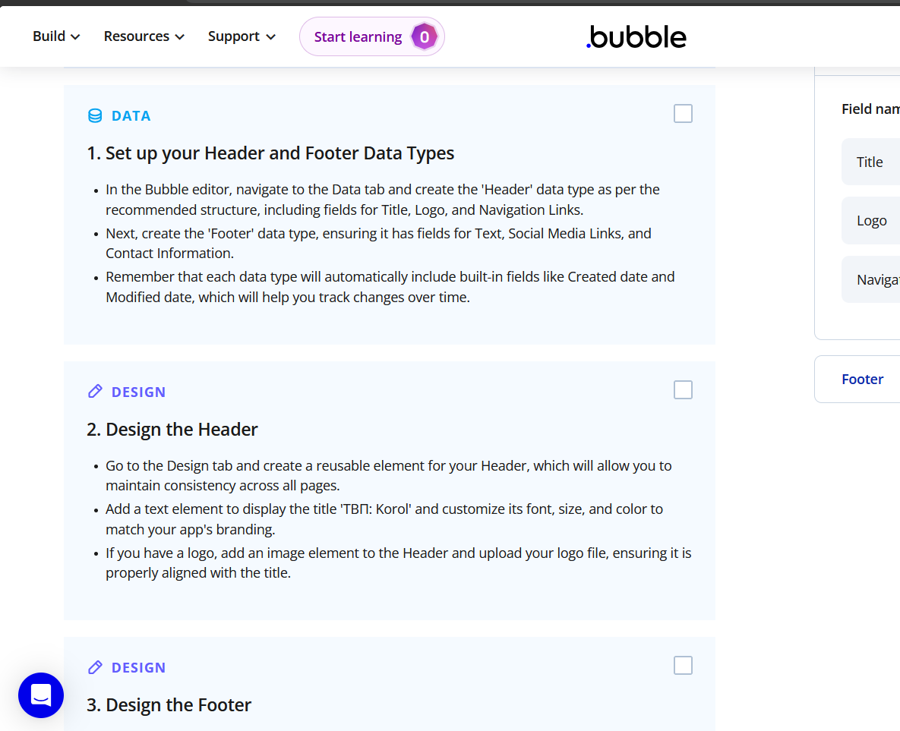
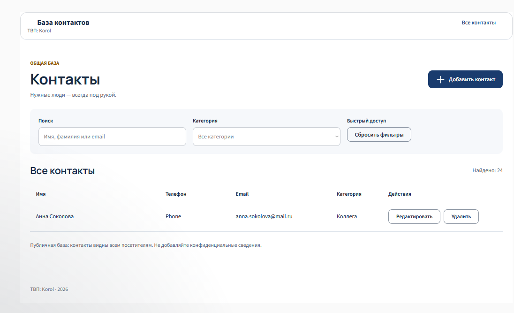
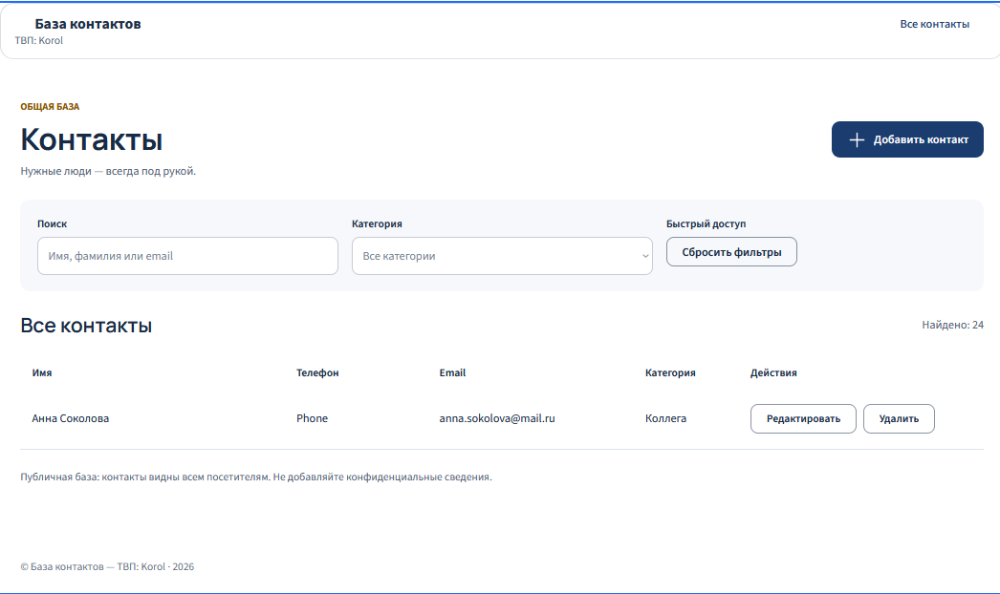
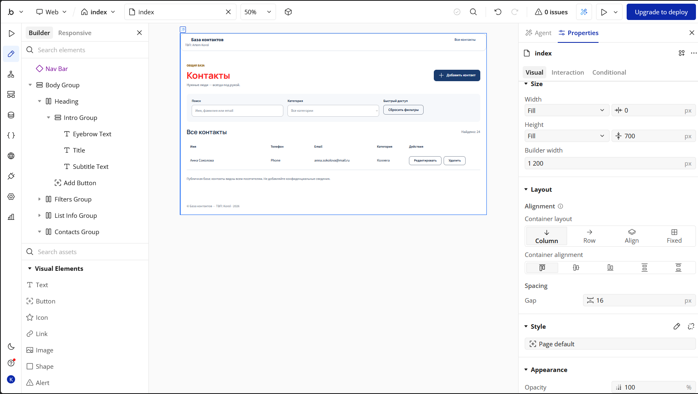
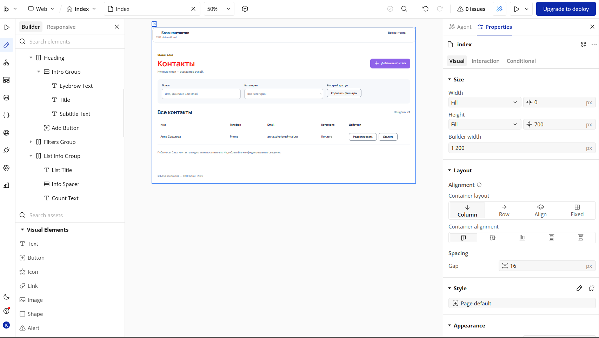
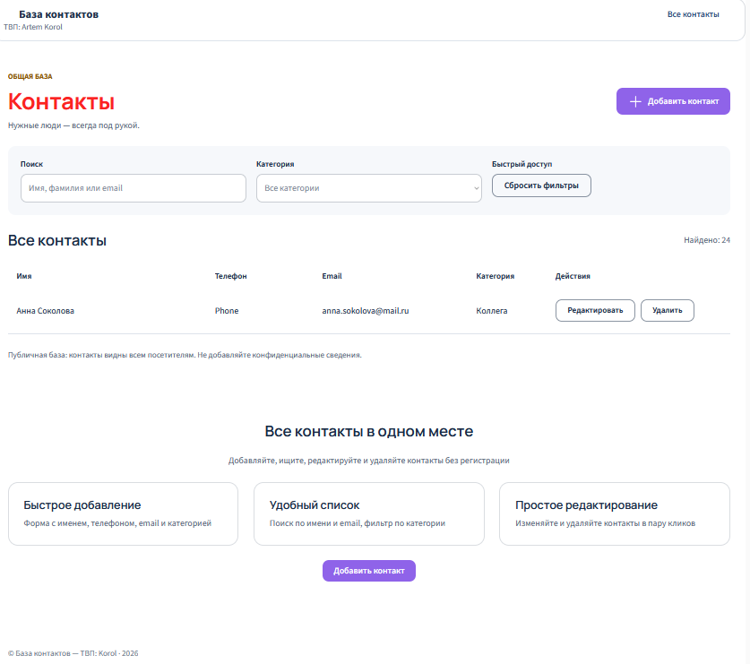
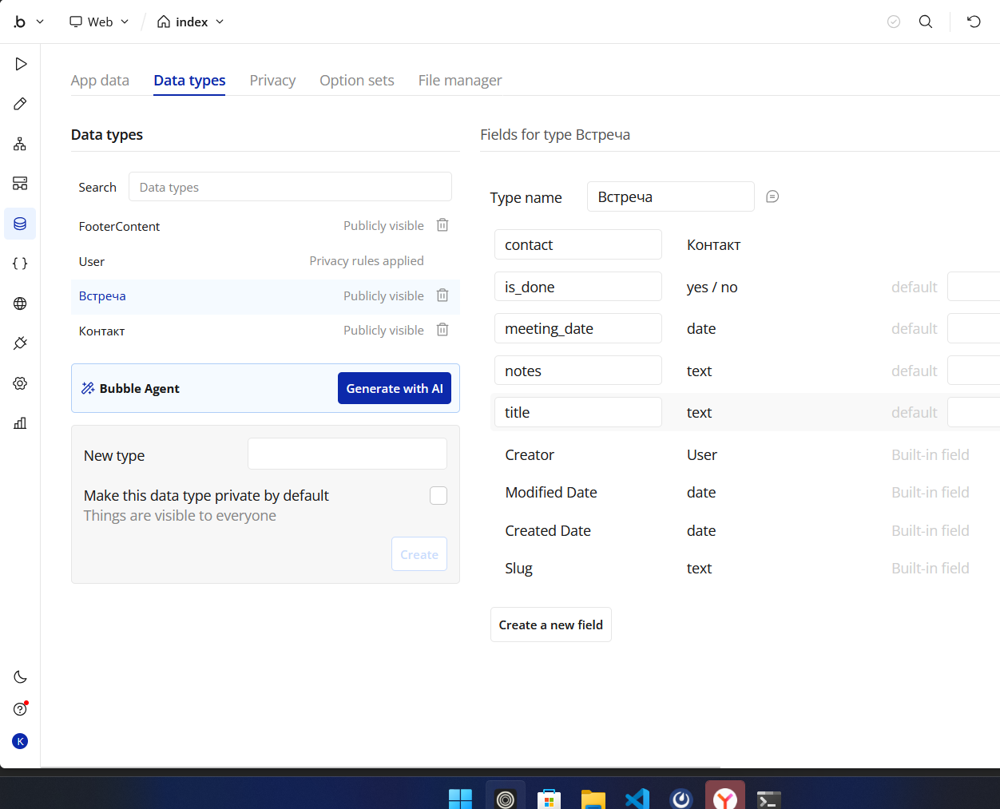
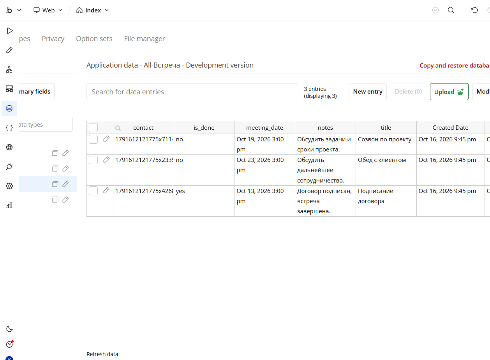

# Отчёт по лабораторной работе №3 «Bubble»

Студент: **Korol**, группа: **ИИ-241**
Репозиторий: `visual-programming-labs-Korol`, папка работы: `lab3/`

---

## 1. Краткое описание выполненного

Тема приложения — **«База контактов»** (публичный сайт, без регистрации).

Создано no-code приложение на платформе Bubble (бесплатный план):
- **Часть 1** — каркас сгенерирован AI-агентом Bubble по промпту (см. раздел 2);
- **Часть 2** — изучен Build Guide про Header/Footer и применена идея
  «динамический футер из базы» (см. раздел 8);
- **Часть 3** — UI доработан вручную: имя «Artem» в заголовке, Global variable `primary-color`
  (Color) для цвета заголовка, кастомный стиль `primary-button`, готовый компонент
  «Section with cards» из COMPONENTS;
- **Часть 4** — новый Data Type `Meeting` («Встреча») и полный CRUD через workflows
  (Create / Read / Update / Delete) на отдельной странице meetings.

---

## 2. Промпт дословно (Часть 1)

```
Создай приложение на тему «База контактов».
Пусть этот сайт будет публичный (без регистрации).
Страницу обязательно создай по структуре header + body + footer.
Обязательно укажи в заготовке следующую строку: «ТВП: Korol».
Добавь несколько интерактивных элементов, реализующих CRUD:
добавление, просмотр списка, редактирование и удаление контактов.
```

---

## 3. Ссылка на dev-версию приложения

_<!-- ВПИСАТЬ: dev-ссылку. В Bubble: Settings → General → "Share" / "Application link",
либо кнопка Preview → "Open in new tab" и скопировать URL -->_

---

## 4. Какие AI-промпты использовались (дословно)

### 4.1 Промпт для генерации каркаса (Часть 1)
см. раздел 2 — промпт вставлен в AI-агента Bubble.

### 4.2 Промпт для сущности в Части 4.1
```
Придумай сущность для приложения «База контактов» — встречи с контактами.
Название сущности — Meeting (Встреча).
Добавь минимум 3 поля разных типов: заголовок (текст), дата встречи (дата),
статус выполнено (да/нет), ссылка на контакт (Contact), заметки (текст).
```

### 4.3 Промпты из исследования идеи (Часть 2)
Для изучения Build Guides и применения идеи «динамический футер» использовался
AI-агент Bubble (встроенный в редактор) с запросом по структуре Header/Footer.
В запросе AI предложил: создать data type `FooterContent` с полями `text` (текст)
и `year` (число), сделать его публично читаемым (сайт без регистрации), добавить
одну запись и привязать текст футера к данным, чтобы менять содержимое в
Data → App data без правки дизайна. Эта идея применена в приложении.

---

## 5. Какие элементы и workflows освоены

**Элементы (Design):** text, button, input, group, header/footer-зоны страницы,
переиспользуемые элементы (reusable element), готовые компоненты из COMPONENTS.

**Данные и стилизация:** Global variables (тип Color), styles (кастомный стиль,
ссылающийся на Global variable).

**Workflows (Часть 4, полный CRUD для `Meeting`):**
- `wf-create-meeting` — Create a new thing (`Meeting`) из полей формы, затем сброс формы и закрытие;
- `wf-read-meetings` — список встреч (Repeating Group), сортировка по дате, сообщение при пустом списке;
- `wf-update-meeting` — Make changes to a thing (редактирование выбранной встречи через ту же форму);
- `wf-delete-meeting` — Delete thing после подтверждения в popup.

---

## 6. Скриншоты всех шагов

| № | Файл | Что на снимке |
|---|---|---|
| 1 | `screenshots/01-prompt.png` | результат генерации каркаса по промпту |
| 2 | `screenshots/02-buildguide-1.png` | изученный Build Guide (Header/Footer) |
| 2 | `screenshots/02-before.png`, `screenshots/02-after.png` | футер до/после подключения к данным |
| 3 | `screenshots/03-global-variable.png` | Global variable (Color) + применение |
| 4 | `screenshots/04-style.png` | новый стиль с использованием переменной |
| 5 | `screenshots/05-component.png` | готовый компонент на странице |
| 6 | `screenshots/06-data-type.png` | Data Type `Meeting` и его поля |
| 7 | `screenshots/07-data-records.png` | записи `Meeting` в App Data (3 шт.) |
| 8 | `screenshots/08-workflow.png` | CRUD-workflows страницы meetings (Create/Read/Update/Delete) |

---

## 8. Исследование идеи (Часть 2)

Изучен Build Guide на bubble.io/home/buildguides по теме оформления
Header и Footer приложения.

### Что посмотрели

Гайд, который разбирает структуру сайта на три зоны (header + body + footer) и
показывает, как оформить заголовок и подвал через переиспользуемые элементы и
подключение данных.



### Что показалось полезным

Идея, что текст футера не обязательно зашивать в дизайн руками — его можно хранить
в базе данных и выводить динамически. Тогда контент меняется в одном месте
(Data → App data), а не переделыванием каждой страницы.

### Что взяли в своё приложение

Реализован **динамический футер на данных**:

1. Создан data type `FooterContent` с полями `text` (текст) и `year` (число) —
   тип `Contact` при этом не затрагивается.
2. Добавлена одна запись: `text` = «© База контактов — ТВП: Korol», `year` = 2026.
3. Тип `FooterContent` сделан публично читаемым (сайт открыт без регистрации).
4. В футере статичный текст заменён на динамический — «первый `FooterContent`'s
   text · первый `FooterContent`'s year». Workflow «Page is loaded» не понадобился:
   текстовый элемент сам читает значение из базы.

Футер теперь показывает «© База контактов — ТВП: Korol · 2026», а поменять текст
или год можно в Data → App data, не редактируя дизайн.

### До / после

**До** (статичный текст футера):



**После** (текст берётся из data type `FooterContent`):



## 9. Ручная доработка UI (Часть 3)

Все изменения внесены вручную в Design-редакторе, без использования AI.

### 3.1 Изменение текста заголовка

В заголовок страницы после строки «ТВП: Korol» добавлено имя студента — **Artem**.
Итоговый заголовок: «ТВП: Korol — Artem».

### 3.2 Global variable для цвета

В разделе Global → Variables создана переменная типа **Color** с именем
`primary-color` (синий, `#2B7FFF`). Она применена к **цвету текста заголовка
«Контакты»** — теперь цвет задаётся одной переменной, а не HEX-значением.



### 3.3 Новый стиль на основе переменной

Создан кастомный стиль `primary-button`, который в качестве цвета использует
Global variable `primary-color`. Стиль применён к кнопке «Добавить контакт» —
это демонстрирует связку «стиль → переменная → единый источник цвета».



### 3.4 Готовый компонент

Из панели COMPONENTS (Drag & drop UI components) выбран готовый компонент
«Section with cards» (раздел с карточками), которого изначально не было на
странице. Он перетащен в приложение и настроен под тему: заголовок раздела,
три карточки-заготовки под контакты и кнопка «Добавить контакт» (со стилем
`primary-button`).


## 10. Data и Workflows — сущность Meeting (Часть 4)

### 4.1 Data Type «Meeting»

Название и поля новой сущности сгенерированы промптом (см. раздел 4.2).

Создан Data Type **Meeting** («Встреча») со следующими полями (5 полей, 4 разных типа):

| Поле | Тип | Назначение |
|---|---|---|
| `title` | text | заголовок встречи |
| `meeting_date` | date | дата встречи |
| `is_done` | yes/no | статус «выполнено» |
| `contact` | Contact | ссылка на контакт |
| `notes` | text | заметки |

В App Data добавлено **3 записи**: «Созвон по проекту», «Обед с клиентом»,
«Подписание договора».





### 4.2 Полный CRUD для Meeting

UI создан с использованием AI, CRUD-логика реализована отдельными workflow на
странице **meetings**. Каждое действие — свой workflow.

#### Create — `wf-create-meeting`
Форма с полями встречи и кнопкой добавления. Workflow создаёт новую запись
`Meeting` (Create a new thing) из значений формы, затем очищает поля и закрывает
форму.


#### Read — `wf-read-meetings`
Список всех встреч (Repeating Group), отсортированный по дате. В строке показаны
название, дата, контакт, статус и заметки. Если встреч нет — выводится сообщение
о пустом списке.

#### Update — `wf-update-meeting`
Кнопка редактирования в строке открывает ту же форму с заполненными данными.
Кнопка сохранения выполняет Make changes to a thing для выбранной встречи.


#### Delete — `wf-delete-meeting`
Кнопка удаления открывает окно «Удалить встречу?». После подтверждения выполняется
Delete thing, при отмене окно просто закрывается.


## 7. Выводы своими словами

_<!-- ВПИСАТЬ после выполнения -->_
