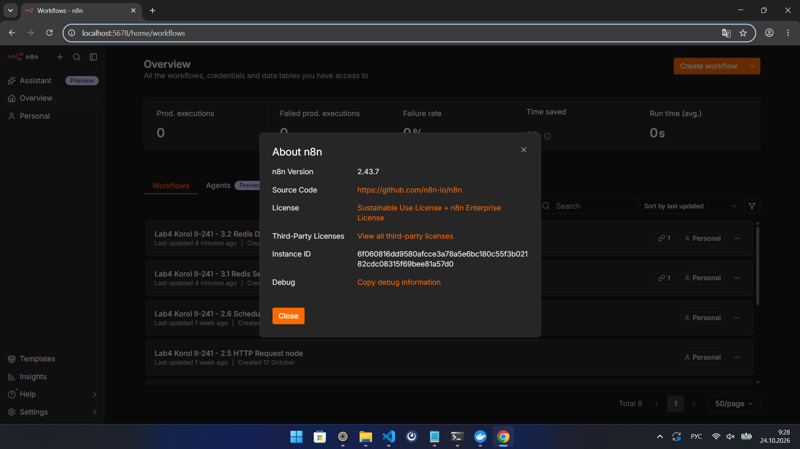
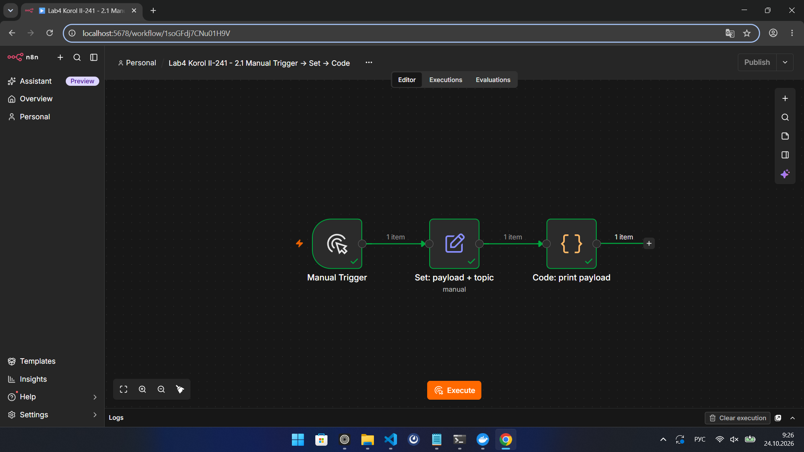
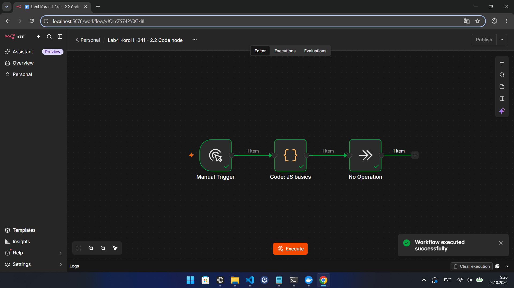
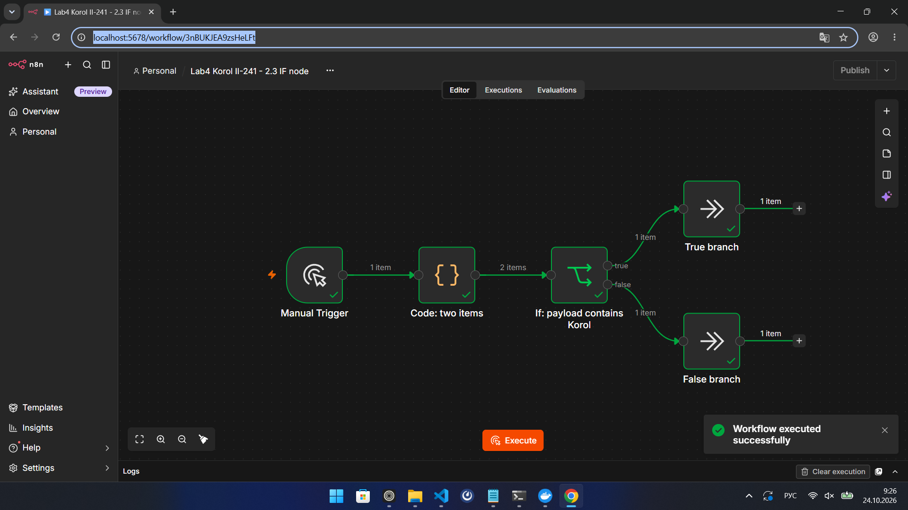
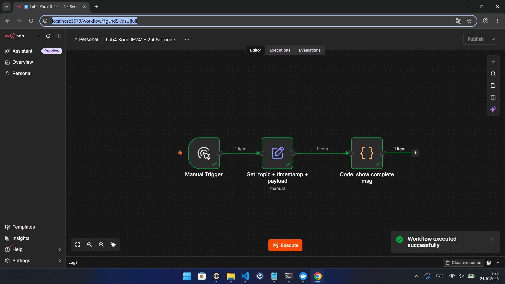
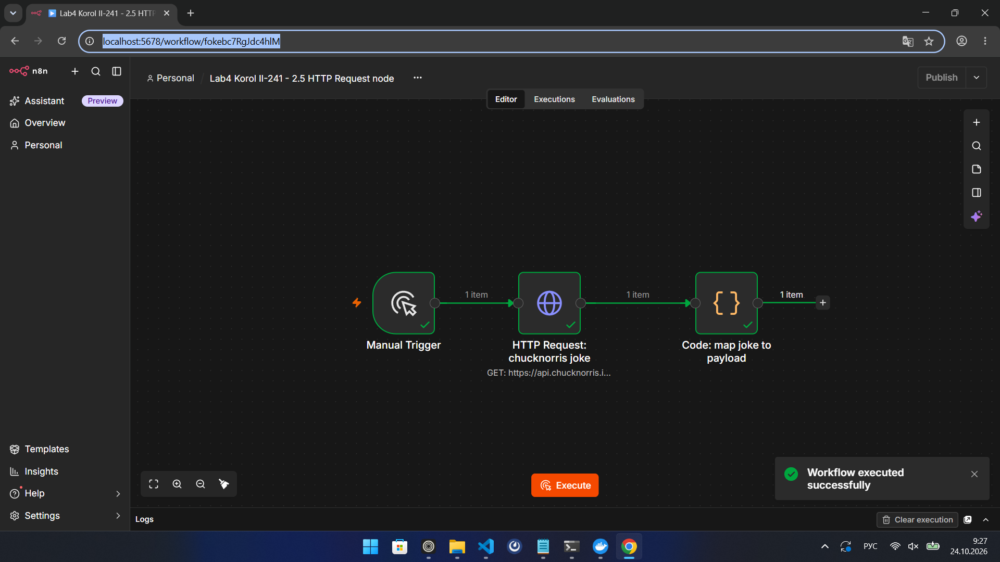
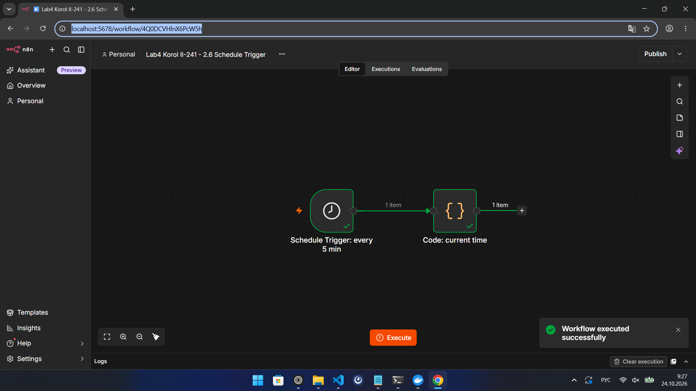
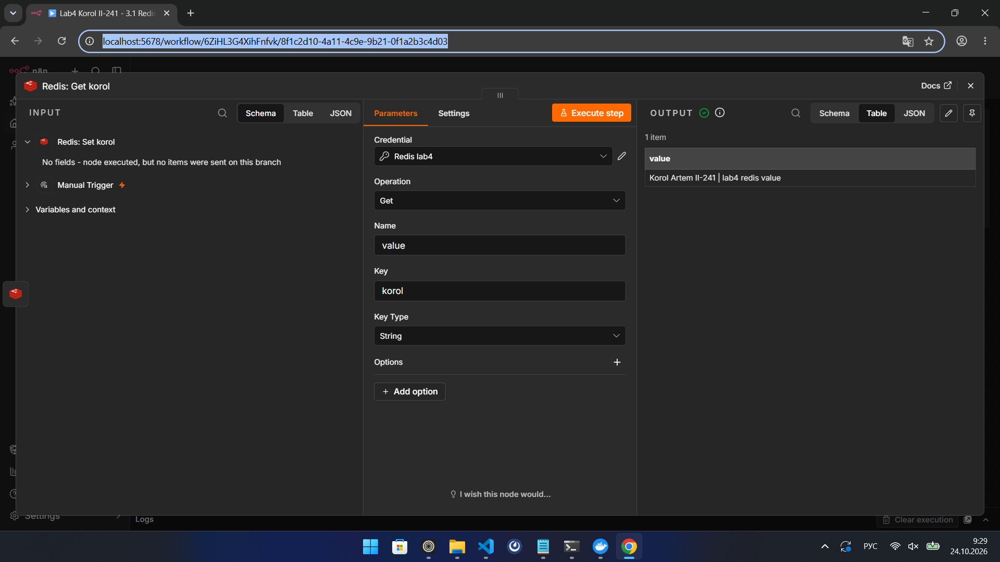
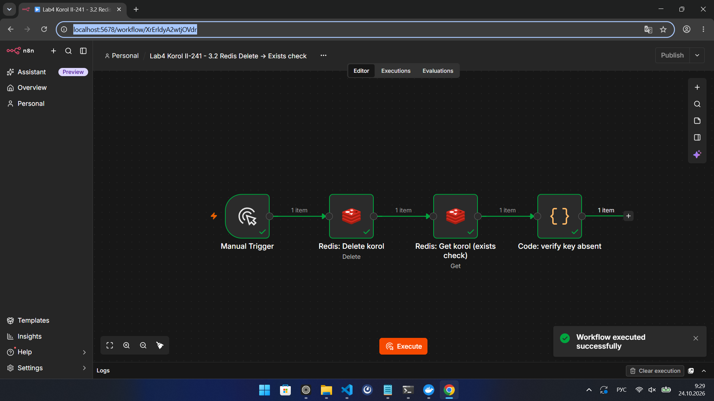
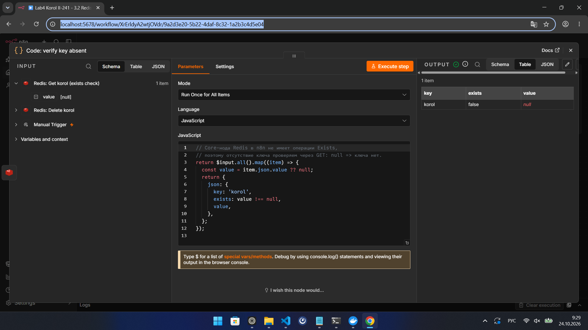

# Отчёт по лабораторной работе №4 «n8n»

Студент: **Korol Artem**, группа: **ИИ-241**
Репозиторий: `visual-programming-labs-Korol`, папка работы: `lab4/`

---

## 1. Краткое описание выполненного

В работе освоен n8n как low-code платформа автоматизации:

* n8n 2.43.7 запущен в Docker с двумя volume (данные инстанса и папка `/data`), порт `5678`;
* собраны и выполнены 6 workflow с базовыми нодами: Manual Trigger, Set, Code, IF, NoOp,
  HTTP Request, Schedule Trigger;
* поднят/использован Redis 7, созданы credentials и два workflow: создание+чтение ключа
  и удаление+проверка отсутствия ключа;
* все workflow экспортированы в `lab4/flows/`, результаты зафиксированы скриншотами.

## 2. Часть 1. Установка и запуск n8n

| Параметр | Значение |
|---|---|
| Образ | `n8nio/n8n` (`latest`) |
| Версия n8n | **2.43.7** |
| Порт | `5678` → http://localhost:5678 |
| Volume 1 | `lab4/n8n-data` → `/home/node/.n8n` |
| Volume 2 | `lab4/data` → `/data` |
| Timezone | `Europe/Minsk` (`GENERIC_TIMEZONE`, `TZ`) |
| Аккаунт владельца | `korolldata@gmail.com` |

Команда запуска:

```powershell
docker run -d --name n8n --restart unless-stopped -p 5678:5678 `
  -v D:\visual-programming-labs-Korol\lab4\n8n-data:/home/node/.n8n `
  -v D:\visual-programming-labs-Korol\lab4\data:/data `
  -e GENERIC_TIMEZONE=Europe/Minsk -e TZ=Europe/Minsk `
  n8nio/n8n
```

Проверка, что контейнер поднялся с нужными volume и портом:

```powershell
docker ps --filter name=n8n
docker inspect n8n --format "{{range .Mounts}}{{.Source}} -> {{.Destination}}{{println}}{{end}}"
# D:\visual-programming-labs-Korol\lab4\data -> /data
# D:\visual-programming-labs-Korol\lab4\n8n-data -> /home/node/.n8n

docker exec n8n n8n --version
# 2.43.7

(Invoke-WebRequest -UseBasicParsing http://localhost:5678/healthz).Content
# {"status":"ok"}
```

После запуска открыт http://localhost:5678 и зарегистрирован владелец инстанса.
Версия из UI (`Help → About n8n`) — на скриншоте `01-version.png`.



## 3. Часть 2. Изучение нод и создание workflow

Все workflow — отдельные файлы в `flows/`, каждый запускался вручную в редакторе n8n;
все запуски завершились со статусом `success` (Executions).

| Пункт | Workflow | Файл | Ноды |
|---|---|---|---|
| 2.1 | Manual Trigger → Set → Code | `flows/flow-01-manual-set.json` | Manual Trigger, Set, Code |
| 2.2 | Manual Trigger → Code → NoOp | `flows/flow-02-code.json` | Manual Trigger, Code, NoOp |
| 2.3 | Manual Trigger → Code → IF → NoOp / NoOp | `flows/flow-03-if.json` | Manual Trigger, Code, IF, NoOp ×2 |
| 2.4 | Manual Trigger → Set → Code | `flows/flow-04-set.json` | Manual Trigger, Set, Code |
| 2.5 | Manual Trigger → HTTP Request → Code | `flows/flow-05-http.json` | Manual Trigger, HTTP Request, Code |
| 2.6 | Schedule Trigger → Code | `flows/flow-06-schedule.json` | Schedule Trigger, Code |

### 2.1. Manual Trigger → Set → Code

* **Set: payload + topic** задаёт `payload = "Korol Artem II-241"` и
  `topic = "lab4/Korol/basic"`.
* **Code: print payload** проходит по всем item, пишет `payload` и `topic` в console.log
  и возвращает входные данные без изменений.

Результат: 1 item, в логах ноды — обе переменные.

### 2.2. Code node

В Code использованы `const`/`let`, массив `topics`, объект `meta`, цикл `for` и `if/else`.
Нода возвращает объект с полем `payload` (например, `"Korol Artem II-241"` и вердикт
`all checks passed`), NoOp завершает цепочку.

### 2.3. IF node

Code формирует два item: `Korol Artem II-241` (score 92) и `Ivanov Ivan II-241` (score 41).
IF проверяет, что `payload` содержит `Korol`, и разводит поток:

* true → **True branch** (NoOp);
* false → **False branch** (NoOp).

На выполнении видно 2 item на входе и по одному на каждой ветке.

### 2.4. Set node (изменение полей)

**Set: topic + timestamp + payload** задаёт `topic = "lab4/Korol/set"`,
`timestamp = {{ $now.toISO() }}` и `payload`. **Code: show complete msg** выводит
полный объект сообщения (`payload`, `topic`, `timestamp`) и возвращает его.

### 2.5. HTTP Request node

**HTTP Request: chucknorris joke** — `GET https://api.chucknorris.io/jokes/random`,
`Response Format = JSON`. **Code: map joke to payload** достаёт `value` из ответа и
формирует `{ payload, source }`. Внешний API отвечает без токенов и регистрации.

### 2.6. Schedule Trigger

**Schedule Trigger: every 5 min** — запуск каждые 5 минут (интервал задан в параметрах
ноды, ручной запуск в редакторе тоже работает). **Code: current time** возвращает
`{ now: new Date().toISOString(), ... }`.

## 4. Часть 3. Redis: создание и удаление ключа

Подробное описание (запуск Redis, credentials, параметры нод, проверка через `redis-cli`) —
в [redis.md](redis.md).

| Workflow | Файл | Ноды |
|---|---|---|
| Создание и чтение | `flows/flow-09-redis.json` | Manual Trigger → Redis (Set) → Redis (Get) |
| Удаление и проверка | `flows/flow-10-redis.json` | Manual Trigger → Redis (Delete) → Redis (Get) → Code |

Redis 7.4.11 слушает `6379`; в n8n созданы credentials **Redis lab4**
(`host.docker.internal:6379`, connection tested successfully).

* Создание ключа: `SET korol "Korol Artem II-241 | lab4 redis value"`.
* Чтение: `GET korol` возвращает это значение (видно в OUTPUT ноды Get).
* Удаление: `DEL korol`.
* Проверка отсутствия: core-нода Redis не имеет операции `Exists`, поэтому после `Delete`
  выполняется `Get` (для отсутствующего ключа — `null`) и Code-нода отдаёт
  `{ key: "korol", exists: false, value: null }`; снаружи `redis-cli EXISTS korol` → `0`.

## 5. Использованные AI-промпты

Ключевые примеры (формулировки сокращены):

1. «Прочитай методичку `Лаб 04 - n8n.docx`, выпиши требования, структуру папок,
   что должно быть в report.md и redis.md; ачивки не делать».
2. «Собери экспорт workflow n8n для пункта 2.1: Manual Trigger → Set → Code,
   payload = "Korol Artem II-241", topic = "lab4/Korol/basic", в Code вывести данные».
3. «В core-ноде Redis нет операции Exists. Предложи корректный способ проверить,
   что ключа нет, и объясни ограничение».
4. «Проверь по Executions, что все workflow завершились успешно, и сними скриншоты
   всего экрана (с панелью задач Windows), а не только области страницы».

## 6. Освоенные ноды

| Нода | Что освоено |
|---|---|
| Manual Trigger | ручной запуск workflow, тестовые выполнения |
| Schedule Trigger | интервальный запуск (каждые 5 минут) |
| Set | фиксированные поля, выражения `{{ $now.toISO() }}`, типы значений |
| Code | JS: `const/let`, массивы, объекты, `for`, `if/else`, `$input.all()`, `$now` |
| IF | условия по строке, ветки true/false |
| No Operation | завершение ветки без побочных эффектов |
| HTTP Request | GET к публичному API, Response Format = JSON, маппинг ответа |
| Redis | credentials, операции Set / Get / Delete, ограничения ноды |

## 7. Скриншоты workflow

| Файл | Что показано |
|---|---|
| `screenshots/01-version.png` | n8n 2.43.7 в UI (About n8n) |
| `screenshots/02-flow-01-manual-set.png` | 2.1 Manual Trigger → Set → Code, выполнен |
| `screenshots/03-flow-02-code.png` | 2.2 Code node → NoOp, выполнен |
| `screenshots/04-flow-03-if.png` | 2.3 IF с двумя ветками, выполнен |
| `screenshots/05-flow-04-set.png` | 2.4 Set с timestamp, выполнен |
| `screenshots/06-flow-05-http.png` | 2.5 HTTP Request (chucknorris), выполнен |
| `screenshots/07-flow-06-schedule.png` | 2.6 Schedule Trigger → Code, выполнен |
| `screenshots/08-redis-set-get.png` | Redis Set → Get, выполнен |
| `screenshots/09-redis-get-output.png` | OUTPUT Get: прочитанное значение ключа |
| `screenshots/10-redis-delete-exists.png` | Redis Delete → Get → Code, выполнен |
| `screenshots/11-redis-exists-output.png` | OUTPUT Code: `exists = false`, `value = null` |




















## 8. Выводы

1. n8n в Docker — это один контейнер и два volume: `~/.n8n` (БД, ключ шифрования,
   credentials) и произвольная `/data` для файлов. Без volume всё состояние теряется при
   пересоздании контейнера, поэтому монтирование обязательно.
2. Set и Code решают разные задачи: Set удобен для декларативных полей и выражений
   (`$now`), Code — для произвольной логики над массивом item'ов; данные между нодами
   передаются как список объектов `{ json: ... }`.
3. IF работает по правилам над полями item, а не по «истинности» всего сообщения:
   на двух входных item'ах сработали обе ветки, что видно по счётчикам.
4. HTTP Request снимает необходимость писать код для интеграции: достаточно метода, URL
   и формата ответа; Code-нода затем приводит ответ к нужной структуре.
5. Schedule Trigger запускает workflow без участия человека; интервал задаётся в ноде,
   а ручной запуск в редакторе позволяет отладить цепочку до включения расписания.
6. Redis в n8n — это простая обёртка над ключ-значение: Set/Get/Delete работают
   предсказуемо, но операции `Exists` в core-ноде нет, поэтому отсутствие ключа
   проверяется через `Get` (`null`) и Code-ноду. Это ограничение полезно знать до
   проектирования автоматизации.
